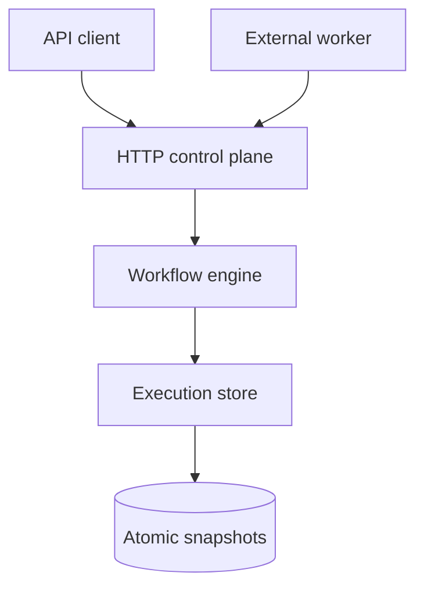
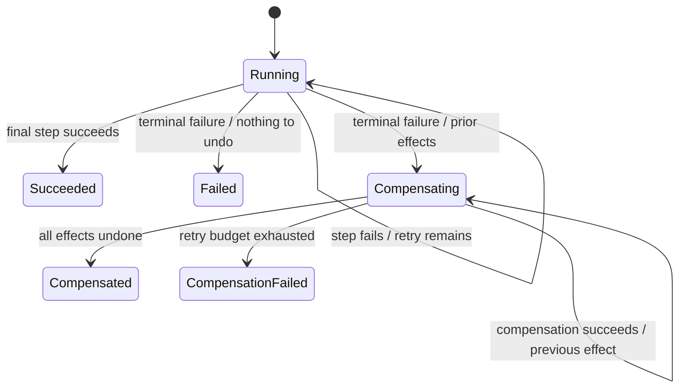

# Architecture

ChronicleFlow separates deterministic workflow transitions from the persistence and transport boundaries. Workers never mutate workflow state directly: they receive a command under a time-bounded lease and report one outcome.



## Execution model

Each execution embeds the exact workflow definition version it started with. Deploying a new definition therefore cannot alter an in-flight execution. A monotonically increasing revision is used for compare-and-swap persistence, while `nextRunAt` makes retry scheduling explicit.

A work command is identified by:

```text
<execution-id>:<forward|compensation>:<step-index>:<attempt>
```

Lease expiry does not consume another execution attempt. The same command identifier is redelivered until a worker reports success or failure. This gives workers a stable idempotency key and keeps transport failures separate from business failures.

## State transitions



## Persistence contract

The bundled adapter serializes all mutation in one process, writes a checksummed envelope to a new file, calls `fsync`, and atomically renames it over the previous snapshot. Reads verify the checksum before returning state. This protects against partial writes and accidental corruption, but it is not a distributed consensus mechanism.

For multi-node deployment, implement `ExecutionStore` using a database that can provide:

- unique constraint on `(workflow_name, idempotency_hash)`;
- conditional update on `revision`;
- indexed query over `status`, `next_run_at`, and `lease_expires_at`;
- transactionally consistent execution and outbox updates.

## Delivery guarantee

Commands are delivered **at least once**. Exactly-once side effects cannot be promised across a network boundary. Workers must persist the command ID alongside their business mutation or forward it as the downstream provider's idempotency key.
